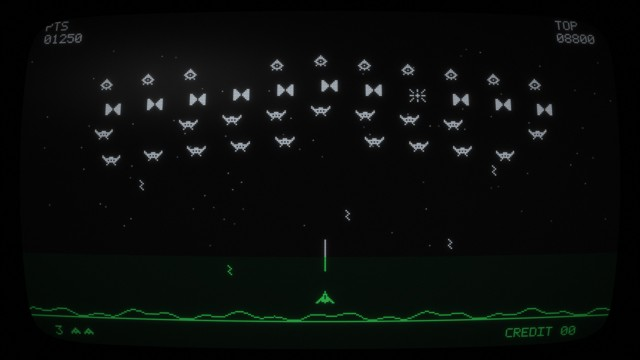

# Star Sentry CRT — fond d'écran animé pour Lively Wallpaper

Fond d'écran animé pour [Lively Wallpaper](https://github.com/lively-community/lively) (Windows), dans l'esprit des bornes d'arcade de la fin des années 70 : écran noir, sprites blancs, bande de gélatine verte en bas de l'écran, et rendu fidèle d'un tube cathodique (points de phosphore, halo lumineux, verre bombé, reflet).

Une partie se joue toute seule en démonstration : la formation d'aliens ondule et descend, le vaisseau tire et esquive, les vagues s'enchaînent.

Aliens, vaisseau et nom « Star Sentry » sont des créations originales.

## Installation

1. Cliquer sur `StarSentry_CRT_Lively.zip` dans la liste des fichiers ci-dessus, puis sur le bouton de téléchargement.
2. Le faire glisser dans la fenêtre de Lively Wallpaper.
3. Cliquer sur la vignette « Star Sentry CRT » pour l'appliquer.

## Réglages

Clic droit sur le fond dans Lively, puis **Personnaliser** :

| Réglage | Effet |
|---|---|
| Affichage | Étiré sur toute la largeur, ou centré (écran vertical de borne) |
| Luminosité | 10 à 200 % |
| Halo lumineux | Intensité de la lueur autour des points (0 à 200 %) |
| Courbure du tube | De plat à très bombé |
| Couleur de la bande du bas | Vert par défaut (essayez l'ambre) |
| Reflet sur la vitre | Activé / désactivé |
| Vitesse du jeu | 25 à 200 % |

Fonctionne à toutes les résolutions (testé en 2560×1440). Comme tout fond Lively, l'animation se met en pause quand un jeu ou une application passe en plein écran.

## Fichiers

- `index.html` — le jeu et l'effet cathodique (WebGL)
- `LivelyInfo.json` — description du fond pour Lively
- `LivelyProperties.json` — les réglages
- `thumbnail.jpg` — la vignette
- `StarSentry_CRT_Lively.zip` — les 4 fichiers ci-dessus, prêts à glisser dans Lively

---

*Animated retro arcade wallpaper for Lively Wallpaper, with a realistic CRT effect (phosphor dots, glow, curved glass, green overlay strip). Original sprites. Download StarSentry_CRT_Lively.zip from the file list and drag it into Lively to install.*
